<picture>
  <source media="(max-width: 600px)" srcset="assets/profile-mobile.svg" />
  
</picture>

Sou de Araripe, no Ceará, e estudo Análise e Desenvolvimento de Sistemas. Desenvolvo aplicações web e APIs, do carrinho que o cliente usa para montar um pedido ao serviço que recebe a confirmação.

[Portfólio](https://marcedoafk.github.io/) · [LinkedIn](https://www.linkedin.com/in/antonio-marcos-9305bb2b4/) · [Pacotes no npm](https://www.npmjs.com/~m4rquin)

##  Projetos em destaque

**[pix-brcode](https://github.com/marcedoafk/pix-brcode)**<br>
Biblioteca TypeScript para gerar, ler e validar Pix copia e cola. Também gera QR Code em SVG e funciona no navegador e no Node.js, sem dependências externas.

<details>
<summary>Gerar um QR Code com a pix-brcode</summary>

Em um projeto Node.js, instale o pacote:

```sh
npm install @m4rquin/pix-brcode
```

Salve como `exemplo.mjs` e execute `node exemplo.mjs`. Abra o arquivo `portfolio.svg` para ver o QR Code que leva ao meu portfólio.

```js
import { writeFileSync } from 'node:fs';
import { qrSvg } from '@m4rquin/pix-brcode';

const svg = qrSvg('https://marcedoafk.github.io/');
writeFileSync('portfolio.svg', svg);
```

</details>

**[Embraza Gringos](https://embrazagringos.com.br/)**<br>
Desenvolvi o fluxo de pedidos da hamburgueria. O cliente monta a sacola, escolhe entre entrega e retirada e acompanha o pedido após a confirmação.

**[Qbombom Sorvetes](https://qbombomararipe.com.br/)**<br>
Criei a experiência de compra da sorveteria, da escolha dos adicionais à revisão do carrinho antes de enviar o pedido.

##  Atividade no GitHub

<picture>
  <source media="(prefers-color-scheme: dark)" srcset="https://raw.githubusercontent.com/marcedoafk/marcedoafk/output/github-snake-dark.svg" />
  
</picture>

[Ver calendário de contribuições no GitHub](https://github.com/marcedoafk#js-contribution-activity)
